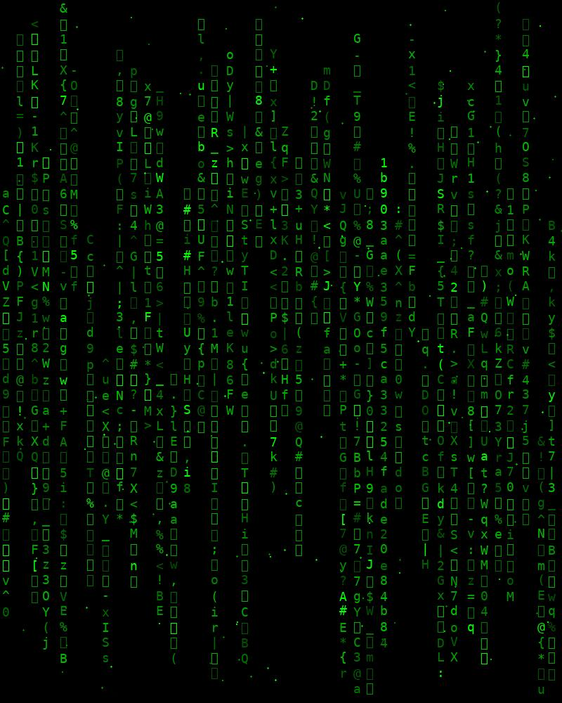
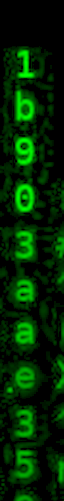
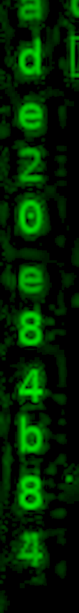

# MATRIX — revisión desde cero y continuación

## Estado

**Pendiente: archivo oculto detectado, contraseña y flag no recuperadas.** No hay fundamento para entregar la columna como flag. El usuario informa que otros competidores relacionaron esa columna con la contraseña de extracción; falta saber si la usaron literalmente o recuperaron primero otra contraseña a partir de ella.

Original conservado: . No se modificó la imagen de Descargas.

## Reconocimiento desde cero

1. `file retomatrix.jpg` identifica un JPEG de 800 × 1000, aunque visualmente parezca una imagen de caracteres.
2. `exiftool retomatrix.jpg` no muestra un comentario o contraseña: solo información técnica del JPEG/JFIF.
3. Al observar las columnas, una mantiene una secuencia de caracteres hexadecimales. No basta con decir «es un MD5»: primero hay que transcribirla y verificar lo que permite hacer.
4. Los recortes de la columna (índice 27 empezando en cero, x aproximadamente 540–560) permiten leer de arriba hacia abajo:

```text
1b903aae359f5ca33254fade20e84b84
```

Son 32 caracteres. Se releyeron los tres recortes: la transcripción coincide con la anterior. La forma es compatible con MD5, pero también con otros hashes o un identificador arbitrario.





## ¿Hay realmente algo oculto con Steghide?

Se volvió a ejecutar:

```bash
stegseek --seed retomatrix.jpg
```

Resultado observado:

```text
Found (possible) seed: "57d7b33c"
Plain size: 42.0 Byte(s) (compressed)
Encryption Algorithm: rijndael-128
Encryption Mode: cbc
```

Es evidencia de un contenido Steghide cifrado. **La semilla no es la contraseña.** Esta opción detecta su estructura, pero no descifra automáticamente un archivo protegido con una contraseña desconocida. Tampoco revela su nombre ni su flag.

## Continuación: qué se comprobó realmente

Hay dos operaciones distintas:

- **Probar una contraseña contra el JPEG:** Steghide/Stegseek.
- **Buscar qué texto produce un supuesto hash:** Hashcat o una tabla pública. Encontrar ese texto tampoco basta: después debe extraer correctamente el contenido del JPEG.

Pruebas nuevas del 3 de octubre:

| Hipótesis | Prueba acotada | Resultado |
|---|---|---|
| Cadena literal con diferencias de lectura o representación | 130 060 variantes contra Stegseek: combinaciones de mayúsculas, cadena inversa, rotaciones, hasta dos sustituciones hexadecimales en la cadena original y otras transformaciones documentadas en el script | Sin contraseña válida |
| Hash NTLM | Hashcat modo 1000 con RockYou | Agotado, sin coincidencia |
| Hash MD4 | Modo 900 con RockYou | Agotado, sin coincidencia |
| MD5 de otra palabra de las listas conservadas | Modo 0 con `work/big.txt`, `work/big2.txt` y `matrix_wordlist.txt` | Agotado, sin coincidencia |
| MD5 de una contraseña numérica corta | Modo 0, todas las cadenas de 1 a 8 dígitos | Agotado, sin coincidencia |
| Doble MD5 del texto hexadecimal del primer digest | Modo 2600 con RockYou | Agotado, sin coincidencia |

Generador reproducible: variantes.py. Estas pruebas descartan esos conjuntos concretos; **no demuestran que la cadena no sea un hash**, ni que el reto esté roto.

## Próximo paso concreto

Después de que el usuario completara el CAPTCHA, se envió la consulta de la cadena en [CrackStation](https://crackstation.net/). Resultado observado: **Type: Unknown; Result: Not found**, 0 coincidencias de 1 hash. Esto no demuestra que no sea un hash: únicamente que esa consulta no produjo una coincidencia en esa base.

También se probaron 2 040 candidatos derivados de cambios de orden (matrices de ancho 2, 4, 8 y 16, transposición, reversas y filas alternadas), desplazamientos hexadecimales, envoltorios y espacios/comillas/saltos de línea. Se pasaron directamente como argumentos a Steghide para conservar los saltos de línea internos de una contraseña, que una wordlist separaría. **Ninguno permitió extraer el archivo.** Generador y comprobación: orden_y_delimitadores.py. Son hipótesis probadas, no pasos de una solución.

Si devuelve una contraseña, comprobarla con:

```bash
steghide extract -sf retomatrix.jpg -p 'CONTRASEÑA_RECUPERADA' -xf matrix-extraido.txt
```

`CONTRASEÑA_RECUPERADA` es un marcador: reemplazarlo por el resultado real. Que se extraiga un archivo y pueda leerse es la validación que falta; no presentar una conjetura como solución.

El siguiente dato de mayor utilidad sería el comando exacto o la contraseña que usó un competidor que sí extrajo el archivo, para comparar con la cadena visible y con esta copia del JPEG. También serviría el enunciado íntegro. Repetir diccionarios ya agotados o acumular transformaciones arbitrarias no resuelve esta incertidumbre. No se ha demostrado que el archivo esté dañado, ni que la lectura de la columna sea la contraseña final.


## Código de apoyo: variantes.py

Guarda este bloque como `variantes.py` si sigues los comandos que lo utilizan. Código del análisis original; no se ha vuelto a ejecutar para esta publicación.

```python
"""Candidatos acotados a la columna leída; no afirma que sea un hash."""
from pathlib import Path
from itertools import product, combinations
import hashlib

h = '1b903aae359f5ca33254fade20e84b84'
out = Path(__file__).parent / 'variantes-columna.txt'
candidates = {h, h[::-1]}
for s in (h, h[::-1]):
    # Posible diferencia de mayúsculas en una cadena usada literalmente.
    options = [(c, c.upper()) if c.isalpha() else (c,) for c in s]
    candidates.update(''.join(p) for p in product(*options))
    for i in range(len(s)):
        candidates.add(s[i:] + s[:i])
    for data in (s.encode(), bytes.fromhex(s)):
        for alg in ('md5', 'sha1', 'sha256', 'sha512'):
            digest = hashlib.new(alg, data).hexdigest()
            candidates.update((digest, digest.upper()))
    for i in range(len(s)):
        candidates.add(s[:i] + s[i+1:])
        for c in '0123456789abcdef':
            candidates.add(s[:i] + c + s[i+1:])
            candidates.add(s[:i] + c + s[i:])
# Dos errores de lectura hexadecimales: prueba finita, no justifica otra lectura.
for i,j in combinations(range(len(h)), 2):
    for a,b in product('0123456789abcdef', repeat=2):
        candidates.add(h[:i]+a+h[i+1:j]+b+h[j+1:])
out.write_text('\n'.join(sorted(candidates))+'\n')
print(f'{len(candidates)} candidatos en {out}')
```

## Código de apoyo: orden_y_delimitadores.py

Guarda este bloque como `orden_y_delimitadores.py` si sigues los comandos que lo utilizan. Código del análisis original; no se ha vuelto a ejecutar para esta publicación.

```python
from pathlib import Path
import hashlib, subprocess

ROOT=Path(__file__).parent
H='1b903aae359f5ca33254fade20e84b84'
words={H,H[::-1]}
for width in (2,4,8,16):
    rows=[H[i:i+width] for i in range(0,32,width)]
    for matrix in (rows, rows[::-1], [r[::-1] for r in rows], [r[::-1] for r in rows[::-1]]):
        words.add(''.join(matrix))
        words.add(''.join(''.join(row[c] for row in matrix) for c in range(width)))
    words.add(''.join(r if i%2==0 else r[::-1] for i,r in enumerate(rows)))
for s in (H,H[::-1]):
    words.update((s[::2]+s[1::2],s[1::2]+s[::2]))
    for offset in range(16):
        words.add(''.join('0123456789abcdef'[(int(c,16)+offset)%16] for c in s))
words.update(s.upper() for s in list(words))
for s in list(words):
    words.add(hashlib.md5(s.encode()).hexdigest())
    for wrapper in ('citc','ctic','cidsi','CITC','CTIC','flag','FLAG'):
        words.add(wrapper+'{'+s+'}')
    for left,right in [(' ',' '),('',' '),(' ',''),('"','"'),("'","'"),('','\n'),('','\r\n'),('','\r')]:
        words.add(left+s+right)
# Direct arguments retain newline passwords that a wordlist cannot represent.
words=sorted(words)
print('Candidatos:',len(words),flush=True)
for i,word in enumerate(words):
    p=subprocess.run(['steghide','extract','-sf','./retomatrix.jpg',
        '-xf',str(ROOT/'extraido-orden.bin'),'-p',word],capture_output=True)
    if p.returncode==0:
        print('ENCONTRADA',repr(word),p.stderr.decode(errors='replace'),flush=True)
        break
else:
    print('Sin extracción válida.',flush=True)
```
