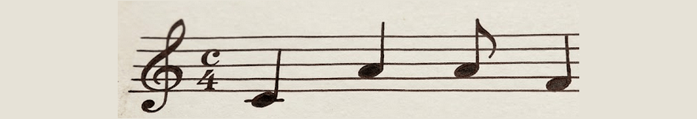
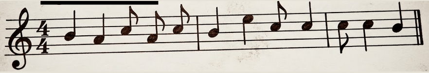

# El mensaje de Ludwing

## Reto

- Plataforma: competencia AGETIC / CITC 2026.
- Categoría: Misceláneo. Puntos: 290. Autor: Rick C-25.
- Archivo: `mensaje.txt` (**original no recuperado**).
- Estado: **parcial: cuatro fotogramas recuperados; falta interpretar la partitura**.

> Dos secuencias como octavas gemelas. La clave estaba en la forma de cada nota, entre lo que inicia y lo que continúa. Dos figuras breves, La y Si, representan marcas que abren y cierran el mensaje.

## Resumen

El TXT era Base64 de un JPEG con un ZIP añadido. El ZIP contenía `partituras.txt`, que era hexadecimal de otra cadena Base64. La siguiente decodificación producía un GIF de cuatro fotogramas con partituras.

## Reconocimiento e hipótesis

```bash
file mensaje.txt
head -c 80 mensaje.txt
```

El comienzo `/9j/` apunta a un JPEG en Base64. Es una hipótesis que se confirma decodificando e identificando el resultado; no por la extensión TXT.

## Resolución parcial paso a paso

Si se recupera el TXT, ejecutar en una carpeta de trabajo:

```bash
base64 -d mensaje.txt > capa1.jpg
file capa1.jpg
binwalk capa1.jpg
unzip -l capa1.jpg
unzip -p capa1.jpg partituras.txt > partituras.txt
xxd -r -p partituras.txt > capa2.b64
base64 -d capa2.b64 > partitura.gif
file partitura.gif
```

`unzip` puede advertir de bytes anteriores al ZIP porque lo precede el JPEG. En el análisis histórico se abrió el ZIP con Python y se leyó únicamente la entrada `partituras.txt`.

El GIF mide **882 × 151** y tiene **cuatro fotogramas**. Para separarlos sin inventar fotogramas intermedios:

```bash
ffmpeg -i partitura.gif -vsync 0 frame-%02d.png
```

Los cuatro fotogramas mostrados durante la competencia sí sobrevivieron en el historial. Son vistas generadas, no el GIF original:






## Cadena de resolución

`Base64 → JPEG + ZIP → partituras.txt → hexadecimal → Base64 → GIF → cuatro partituras → pendiente`

## Flag

**No recuperada.** Queda por demostrar la tabla que convierte alturas y figuras en letras o llaves. El enunciado sugiere que importan ambas propiedades, pero no se obtuvo una correspondencia validada.

## Qué debo recordar para otro CTF

Un archivo de texto puede transportar un archivo binario completo. Tras encontrar una imagen, revisar si contiene un segundo formato. Separar los fotogramas antes de intentar leer una animación rápida.

## Aporte para el arsenal

Encadenar decodificaciones detectables, conservar cada capa y extraer fotogramas. No adivinar un cifrado musical a partir de solo dos notas.
