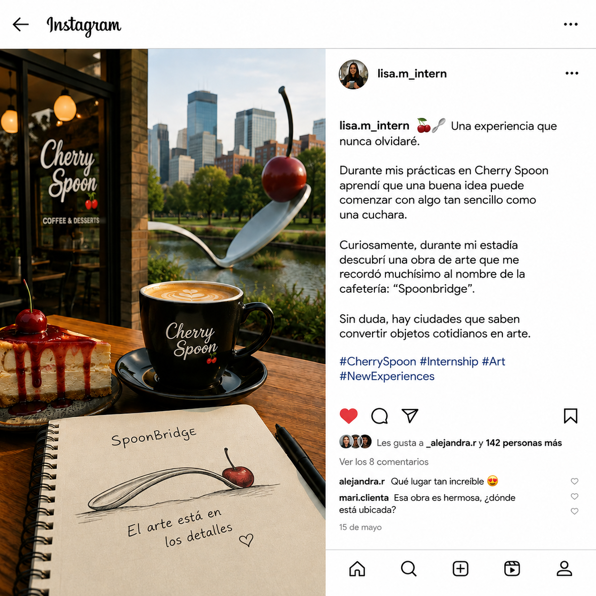

# Una cuchara, una experiencia y una ciudad

## Reto

- Plataforma: competencia AGETIC / CITC 2026.
- Categoría de trabajo: OSINT. Puntos: 50. Autor: GK4ME.
- Imagen: .
- Estado: **parcial; respuestas propuestas rechazadas**.

> Encontrar la «Place» de unas prácticas a partir de un post sobre una cafetería y una obra de arte, y después el número de dirección.

## Reconocimiento

El post de `lisa.m_intern` dice que hizo prácticas en **Cherry Spoon** y que una obra llamada **Spoonbridge** le recordaba el nombre de la cafetería. La imagen representa una cuchara gigante con una cereza.

## Hipótesis y recorrido realizado

1. Relacionar Cherry Spoon con **Spoonbridge and Cherry**.
2. Identificar Minneapolis Sculpture Garden y el cercano Walker Art Center.
3. Consultar las direcciones: Walker figura en **725 Vineland Place**; la ficha del parque usa **726 Vineland Place**. Algunos directorios de la escultura muestran **14357 Loring Greenway**.
4. Se propusieron números y variantes de direcciones. El usuario indicó que no funcionaban.

Fuentes consultadas durante la competencia:

- [Walker Art Center: visita](https://www.walkerart.org/visit/).
- [Minneapolis Park Board: jardín de esculturas](https://www.minneapolisparks.org/parks-destinations/parks-lakes/gardens__bird_sanctuaries/minneapolis_sculpture_garden/).
- [Ficha secundaria de la escultura](https://wanderlog.com/place/details/110870/spoonbridge-and-cherry).

## Corrección del razonamiento

**No se demostró que las prácticas fueran en el museo:** el post menciona la cafetería. Tampoco se demostró que «Place» significara Google Places o el sufijo de Vineland Place. Esas afirmaciones fueron inferencias excesivas. Encontrar la ciudad no equivale a encontrar el local ni el dato final solicitado.

## Cadena de resolución

`post → identificación de escultura y ciudad → salto no demostrado al lugar de prácticas → respuestas rechazadas`

## Flag

**No recuperada.** No volver a presentar 725, 726 o 14357 como respuestas verificadas.

## Qué debo recordar / aporte para el arsenal

Separar hechos visibles, identificación geográfica e hipótesis. Las variantes de separadores no arreglan una identificación sin demostrar. No automatizar envíos de direcciones al azar.

## Archivos

Se recuperó el PNG incluido en el mensaje del historial. Es una copia del adjunto conservado por la aplicación; no se encontró el archivo independiente de Descargas para compararlo.
