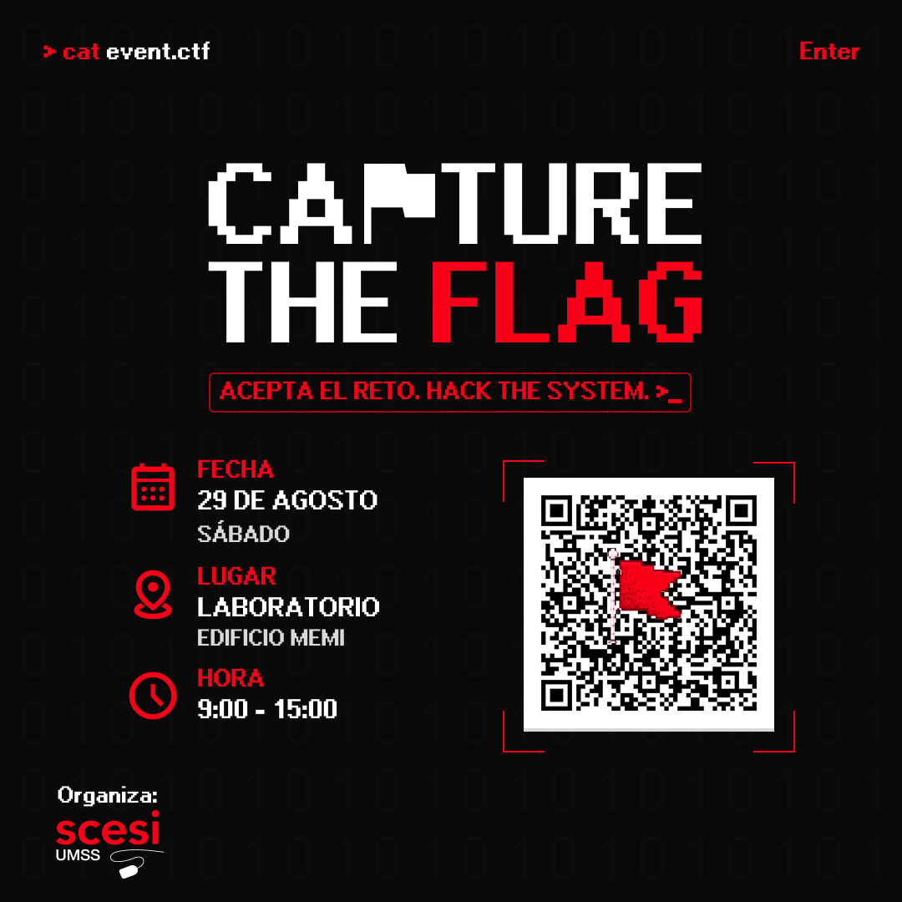

# Write-up: Nada sospechoso aquí

## Reto

- Plataforma: CTF SCESI
- Nombre: Nada sospechoso aquí
- Categoría: Esteganografía
- Puntos: 100
- Archivo/objetivo: imagen PNG publicada en `sharebin.eu`
- Estado: `resuelto`

> ¿Viste qué bien nos quedó el post? Todo se ve perfectamente normal, no hay ni un byte fuera de lugar...

## Reconocimiento visual

Archivo conservado en el vault: . El 27 de septiembre de 2026 se repitió `zbarimg --quiet --raw` seguido de `base64 -d` sobre el archivo del paquete SCESI y se recuperó la misma flag.

La imagen es un afiche de un evento. En su parte inferior derecha aparece un código QR claramente visible. Por ello, la primera hipótesis no necesita herramientas de esteganografía avanzada: antes de buscar LSB, metadatos o archivos anexados, conviene comprobar el elemento que la propia imagen invita a escanear.

El texto «no hay ni un byte fuera de lugar» también sugiere que quizá no existe corrupción ni contenido agregado al archivo. El secreto puede estar en el contenido lógico del QR.

## Leer el código QR

Se puede utilizar la cámara de un teléfono o hacerlo desde la terminal con `zbarimg`:

```bash
zbarimg --quiet --raw d1d4a2741e8d2153e1f9aa795be03566.png
```

La opción `--raw` muestra solamente el contenido leído y evita el prefijo `QR-Code:`. El resultado es:

```text
LS0tLS0tLS0tLS0tLS0tLS0tLS0tLS0tLS0tLS0tLS0tLS0tPnVtc3NjdGZ7dW5fcXJfcGFyYV9kZXNjb25maWFyX1hEfTwtLS0tLS0tLS0tLS0tLS0tLS0tLS0tLS0tLS0tLS0=
```

Esto todavía no tiene el formato de una flag. Sin embargo, usa únicamente caracteres propios de Base64 y termina en `=`, que funciona como relleno (*padding*). Es razonable probar esa decodificación.

## Decodificar la segunda capa

```bash
zbarimg --quiet --raw d1d4a2741e8d2153e1f9aa795be03566.png | base64 -d
```

Resultado:

```text
------------------------------------>umssctf{un_qr_para_desconfiar_XD}<------------------------------
```

Las flechas y los guiones solamente enmarcan el mensaje. La flag es la cadena delimitada por llaves.

## Flag

```text
umssctf{un_qr_para_desconfiar_XD}
```

## Cadena de resolución

`PNG → inspección visual → QR visible → contenido Base64 → decodificación → flag`

## Qué debo recordar para otro CTF

- Empezar por la inspección visual; no todos los retos de esteganografía requieren buscar píxeles o bits ocultos.
- Leer un QR no garantiza que su contenido sea directamente la flag. El resultado debe volver a analizarse como una nueva capa.
- Una cadena Base64 suele contener letras, números, `+` y `/`, y puede terminar en uno o dos signos `=`. Es una pista, no una demostración absoluta.
- El logotipo rojo superpuesto sobre el centro no impide leer el QR porque estos códigos incorporan corrección de errores.
- Conservar exactamente mayúsculas y minúsculas: `_XD` no debe convertirse en `_xd`.
- Si `zbarimg` falla, probar primero con un recorte del QR, ampliar sin suavizado o emplear la cámara de un teléfono antes de asumir que existe otra técnica.

## Aporte para el arsenal de esteganografía

- Detectar códigos QR visibles al realizar el triage de una imagen.
- Devolver el contenido leído al decodificador por capas, en lugar de detenerse tras encontrar el QR.
- Mostrar la ruta completa y comprobable: `QR → Base64 → texto`.
- No ejecutar automáticamente técnicas costosas si una inspección sencilla ya produce evidencia clara.
